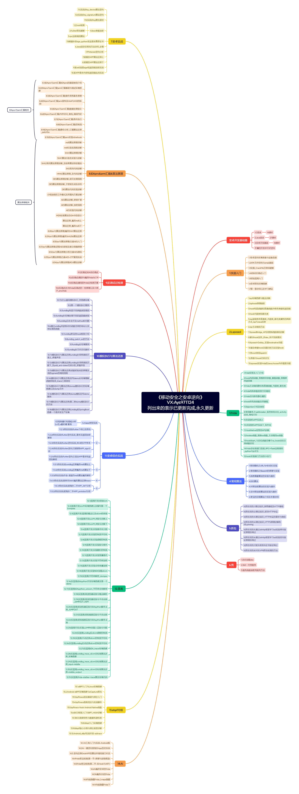
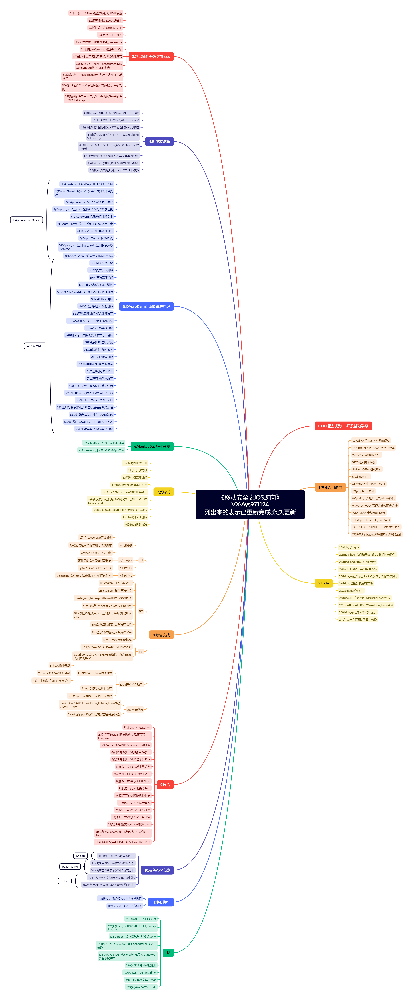
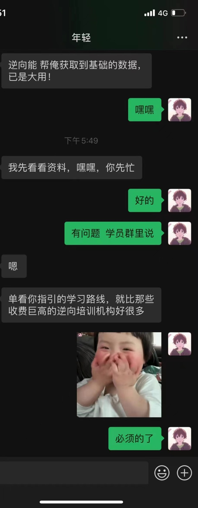
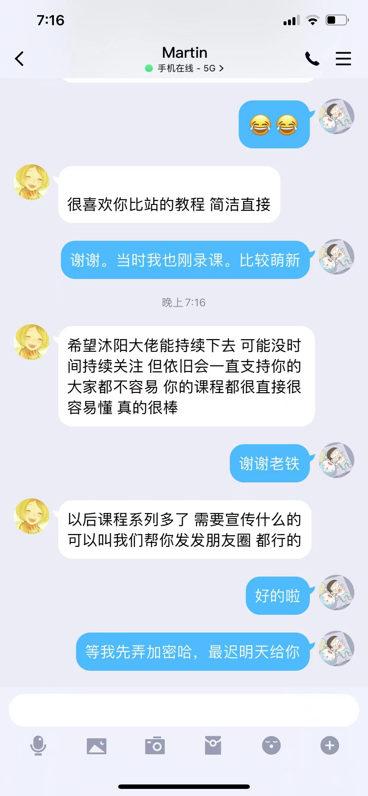
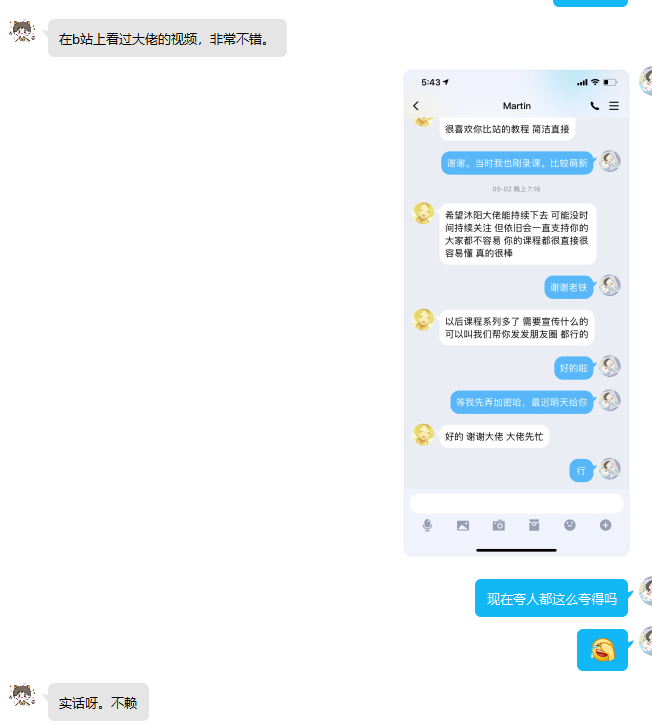
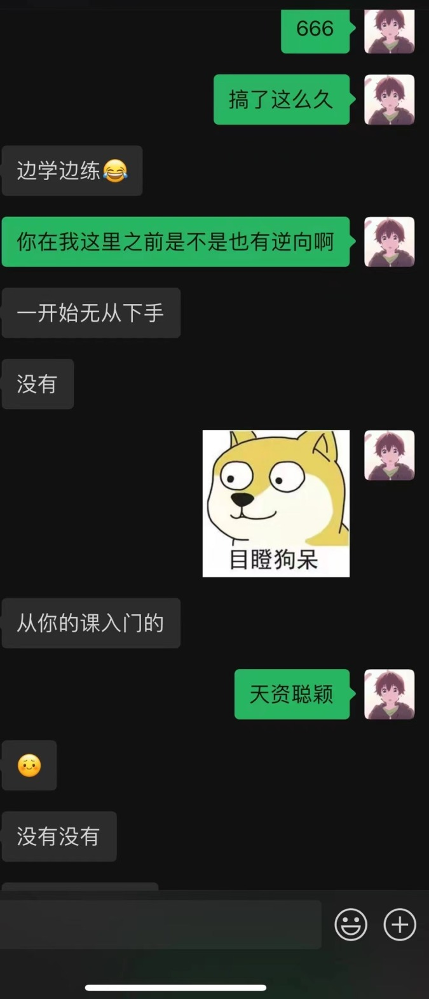
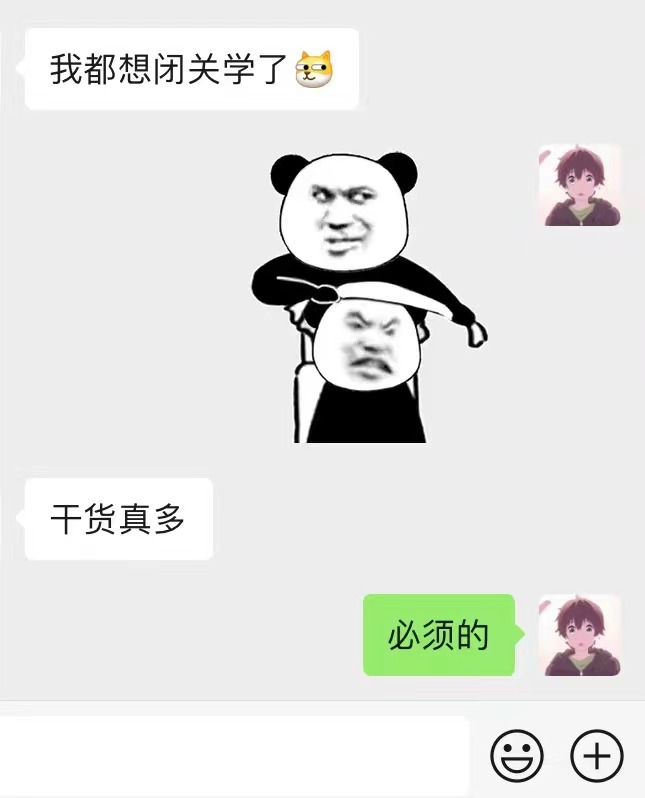
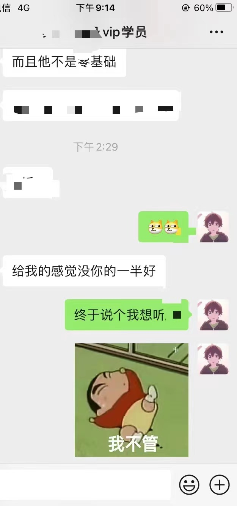
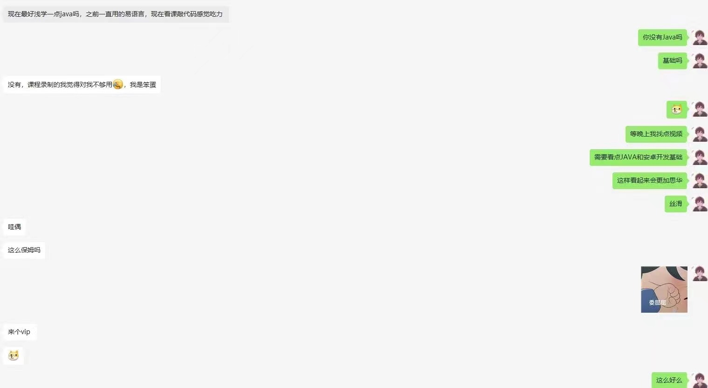
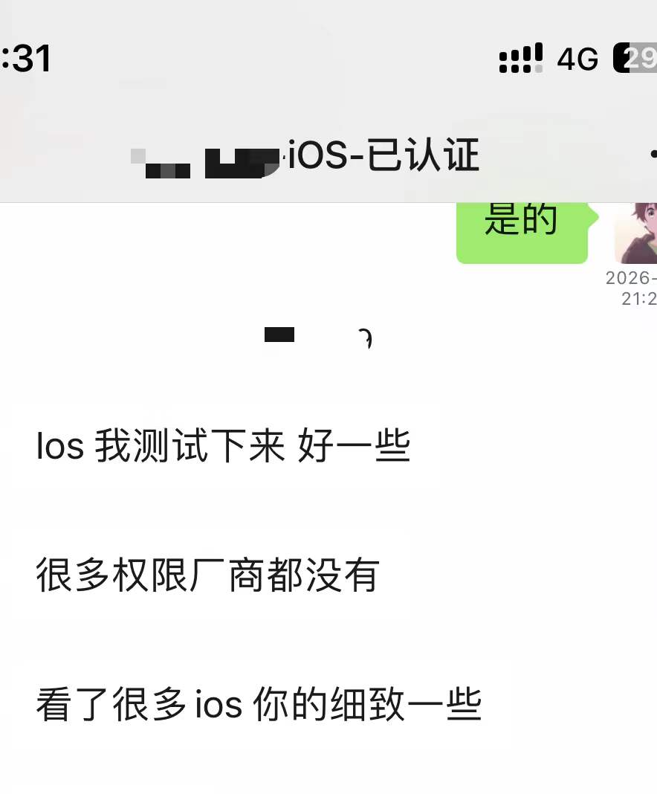

# 和沐阳学逆向与Ai — 安卓 / iOS 双端逆向与 AI 实战系统课

> 从看不懂一行汇编，到结合 AI / MCP 工作流独立还原大厂 App 核心加密与风控算法

**B站「和沐阳学逆向与Ai」 · 750+ 名付费学员 · 2024 至今每月不断更 · 深度融合 AI + MCP 逆向实战 · 学员已入职滴滴 / 携程 / 虾皮 / 360 等大厂**

---

## 关于讲师

沐阳（B站：**[和沐阳学逆向与Ai](https://space.bilibili.com/439348342)**），专注移动安全逆向领域多年，深耕 Android 与 iOS 双平台逆向与风控对抗技术。

- 累计培养 **750+ 名付费学员**，覆盖 Frida / IDA Pro / OLLVM / Unidbg / Chomper / eBPF / Flutter / Swift / AI MCP 等一线实战技术栈
- 学员已成功入职滴滴、携程、虾皮（Shopee）、360 及多家头部安全与数据企业

> 不卖焦虑，只教当下依然能打穿真实商业 App 的硬核技术。

---

## 为什么「AI 都出来了」，更要学这套逆向课？

很多同学观望时会问：**“现在大模型这么强，AI 能不能直接帮我一把梭做逆向？”**

答案非常现实——**0 基础 × AI = 0；懂逆向底层 × AI = 5~10 倍效率。**

面对现代商业 App 的**企业加固壳、内核/ART 反调试、Frida maps 检测、设备指纹风控、OLLVM 混淆与魔改算法**，外行连包都抓不到、干净的二进制都提取不出来，AI 根本连门都进不去，对着残缺伪代码只会一本正经胡说八道。

- **AI 淘汰的是**：过去靠肉眼硬啃几千行伪代码、死记硬背的苦力式学法；
- **AI 放大的是**：懂底层破防的人，接上 **Jadx-MCP + IDA-Pro-MCP + AI 魔改工具链** 后，以前熬两年的硬核技术现在两个月就能实战上手！

本课程已将 **AI + MCP 自动化实战** 深度融进安卓与 iOS 双端：
- **MCP 全链路联动**：`jadx-mcp` + `ida-pro-mcp` 实战分析海外大厂 App（如 Grok gRPC / secp256k1 / Protobuf、Instagram、Pinterest 等）
- **AI 魔改过检测工具**：AI 辅助魔改安卓 / iOS 双端 Frida 过检测与内核隐藏 maps 实战
- **AI 辅助反混淆与还原**：喂对运行时上下文，让 AI 精准读懂 IDA 伪代码、定位加密入口并生成还原脚本
- **每月同步新玩法**：AI 逆向工具与大厂风控迭代极快，**一次报名，永久免费更新**。

---

## 为什么坚持「一次付费，永久更新」？

逆向是一门技术迭代极快的手艺——App 版本一更，检测就变，两年前的老录播根本打不开今天的样本。

这套课从 2024 年开课至今**保持每月持续更新**（完整更新日志见 [CHANGELOG.md](CHANGELOG.md)）。你付一次费，学到的永远是 2026 年当下还能用的最新对抗与 AI 工作流，750+ 位老学员的口碑就是最好证明。

**想了解课程试看或学习规划？加微信聊：Ays971124**

---

## 免费试看视频（先看讲课风格，满意再聊）

- **安卓入门试看**：[2026沐阳安卓逆向从零入门系列](https://www.bilibili.com/video/BV1WyLM6uECQ)
- **iOS 入门试看**：[2026沐阳iOS逆向从零入门系列](https://www.bilibili.com/video/BV1MtG76wEjh)
- **高阶对抗试看**：[84.frida常见检测(第一节-原理与进程痕迹)](https://www.bilibili.com/video/BV1mXMU66EuY)

---

## 课程介绍

### 安卓逆向课程 - 2999元

**适合**：零基础 / Java 开发转型 / 安全与爬虫从业者进阶

**你将掌握**：
- Hook 与内核对抗：Frida、LSPosed、内核隐藏 Frida maps、反调试与 ART 过检测
- 脱壳与加固：企业壳分析、抓包对抗、eBPF / eCapture / ssltrace 无感追踪
- SO 层与算法还原：ARM 汇编、IDA Pro、魔改加密算法、OLLVM 反混淆、白盒 AES、Unidbg 模拟执行
- 专项突破：Flutter 逆向、gRPC / Protobuf 协议分析
- **AI + MCP 实战**：`jadx-mcp` + `ida-pro-mcp` 全链路联动、AI 一键辅助还原海外 App 签名、AI 魔改 Frida 过检测

**核心章节速览（文字版，便于检索）**：
`01` 环境搭建与 Smali/JEB/抓包入门 → `02` Frida/LSPosed Hook 与 RPC 实战 → `03` 常规与魔改加密算法（MD5/SHA/AES/RC4/白盒AES） → `04` ARM 汇编与 IDA Pro SO 层分析 → `05` OLLVM 反混淆与 Unidbg 模拟执行 trace → `06` Flutter 与 gRPC/Protobuf 协议还原 → `07` eBPF / eCapture / ssltrace 无感抓包 → `08` Frida 反检测、内核隐藏 maps 与 AI/MCP（`jadx-mcp` + `ida-pro-mcp`）实战。

点击查看完整安卓课程大纲

---

### iOS 逆向课程 - 2999元

**适合**：零基础 / iOS 开发转型 / 移动安全研究员

**你将掌握**：
- 越狱与环境对抗：有根 / 无根越狱（配套沐阳实验室专属越狱源）、常见越狱检测与 Frida 过检测、Theos 插件开发
- 动态分析：Frida Hook、内存漫游、RPC 调用、海外主流 App 抓包与协议分析
- 静态与底层还原：ARM 汇编、IDA Pro、Swift / ObjC 混编逆向、白盒 AES、Chomper 模拟执行
- 工具开发：巨魔（TrollStore）App 开发、逆向助手开发
- **AI + MCP 实战**：AI + `ida-pro-mcp` 辅助分析 Swift/ObjC 伪代码、AI 还原签名与设备指纹链路、AI 魔改 iOS Frida 过检测

**核心章节速览（文字版，便于检索）**：
`01` iOS 学前须知与有根/无根越狱环境（含沐阳实验室越狱源） → `02` 砸壳、Theos 插件与巨魔（TrollStore）App 开发 → `03` Frida Hook、内存漫游与海外 App（Instagram/Grok 等）抓包协议 → `04` ARM 汇编、IDA Pro、ObjC/Swift 混编与白盒 AES → `05` Chomper 模拟执行与算法还原 → `06` 越狱/Frida 检测对抗、AI 魔改 iOS Frida 与 `ida-pro-mcp` 实战。

点击查看完整 iOS 课程大纲

---

### 双课套餐 - 5398元（原价 5998，立省 600）

安卓 + iOS 一起报，打通移动端双平台逆向与 AI 自动化能力，比单报立省 600。名额与学习规划直接加微信咨询。

---

## 近期更新记录（每月持续更）

完整历史更新见 [CHANGELOG.md](CHANGELOG.md)。

**2026 年 9 月（安卓新增）**：
- 14.8 内核隐藏 Frida 上（maps 隐藏）
- 14.9 内核隐藏 Frida 下

**2026 年 8 月（双端 AI 魔改与过检测）**：
- 安卓 14.4 - 14.5 Frida 常见检测（原理、进程痕迹、反 Hook 与 ART）
- 安卓 14.6 - 14.7 / iOS 12.6 - 12.9：iOS 越狱/Frida 检测 + **AI 魔改安卓与 iOS Frida**

**2026 年 5 月（基础章节全面重置）**：
- 安卓第一章全新重置（1.1 - 1.7 环境搭建、Smali、CrackMe、JEB 动态调试、抓包与混淆入门）
- iOS 1.0 快速入门学前须知

**2026 年 1–3 月（eBPF & MCP 实战专题）**：
- 安卓 13.6 - 13.10 eBPF / BCC / libbpf / ssltrace
- 双端 Grok App 逆向（secp256k1 / gRPC / Protobuf）+ **`jadx-mcp` & `ida-pro-mcp` 实战**、Instagram / Pinterest 实战

---

## 学完能干什么？

- 独立完成主流国内及海外 App 的协议分析、风控对抗与算法还原
- 胜任大厂与安全公司的 **移动安全风控 / 逆向分析 / 安全蓝军 / 高级 App 爬虫工程师** 岗位
- 熟练结合 AI / MCP 工具链成倍提升逆向分析与脚本开发效率

---

## 为什么选这套课？

| 优势 | 说明 |
|------|------|
| 一次付费永久更新 | 2024 至今每月稳定加更，AI 与新风控玩法全部免费解锁 |
| 体系化实战驱动 | 从 0 基础到内核/eBPF/白盒/MCP，全是真实商业 App 案例 |
| 750+ 学员口碑沉淀 | 答疑群随时响应不卡壳，老学员持续推荐 |
| 专属就业内推 | 合作涵盖头部安全公司与一线互联网大厂，详见 [内推专区](内推专区/文字描述区.md) |
| 配套资源齐全 | 赠送知识星球永久会员 + 沐阳逆向实验室 iOS 越狱源 |
| 支持分期付款 | 花呗、信用卡分期均支持 |

---

## 学员评价

> 以下为部分学员真实反馈，更多评价可点击下方展开查看。

  
  

点击查看更多学员评价截图（共 7 张）

---

## 联系方式

| 渠道 | 信息 |
|------|------|
| 微信 | `Ays971124` |
| B站 | [和沐阳学逆向与Ai](https://space.bilibili.com/439348342) |

---

**想系统学习安卓 / iOS 逆向与 AI 自动化实战？直接加微信：`Ays971124` 咨询。**
